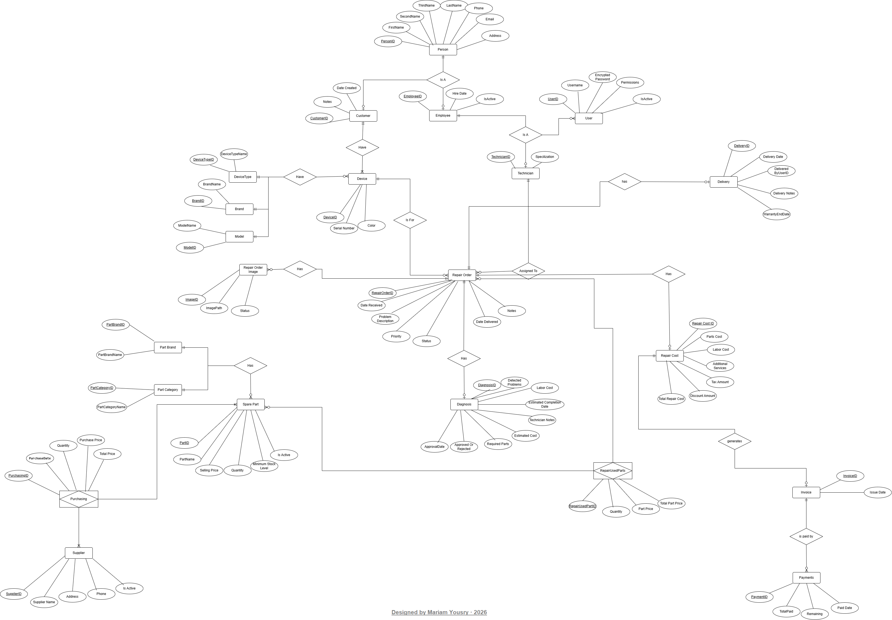
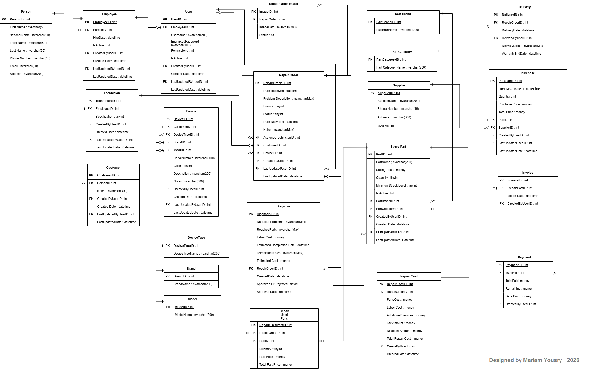
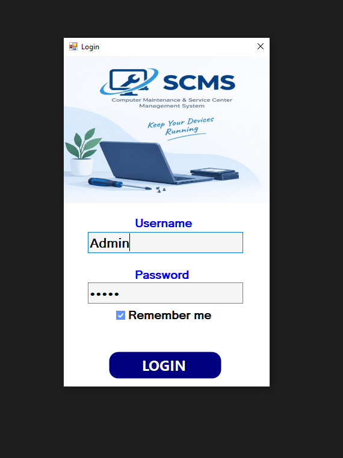
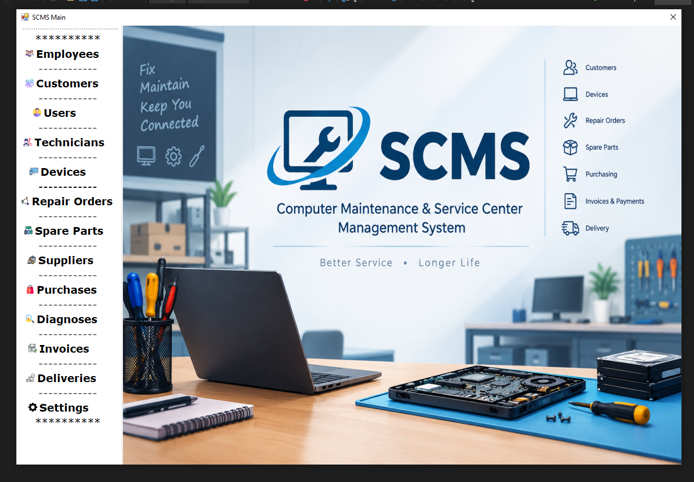
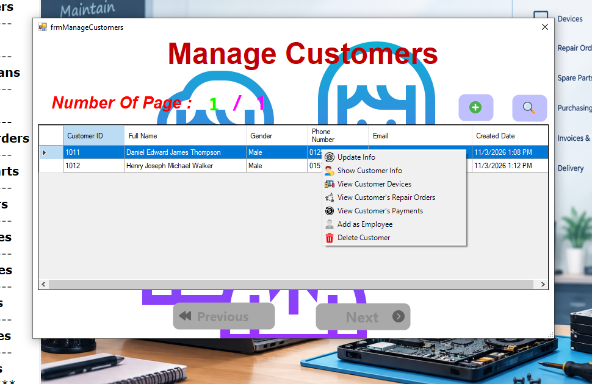
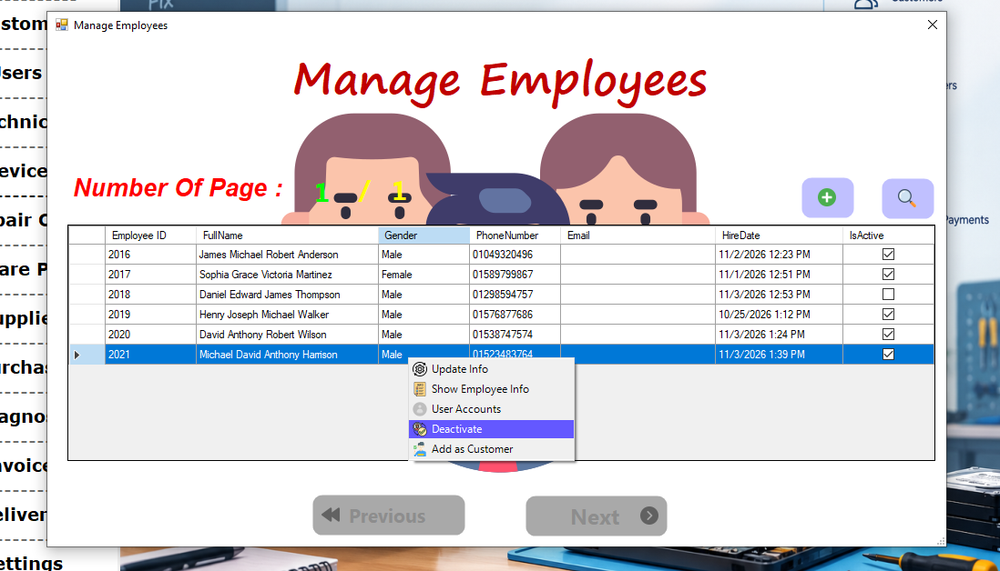
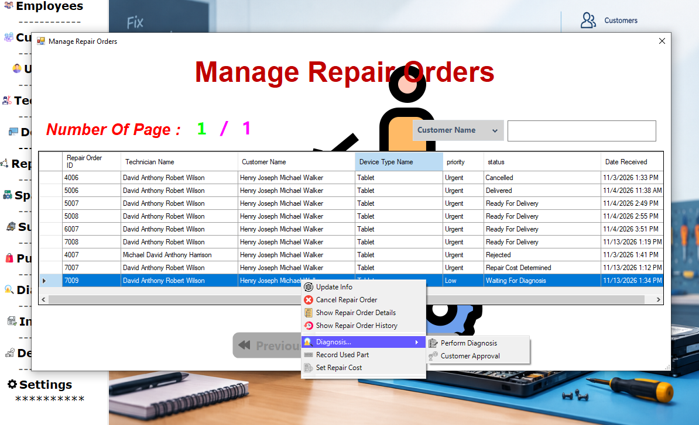
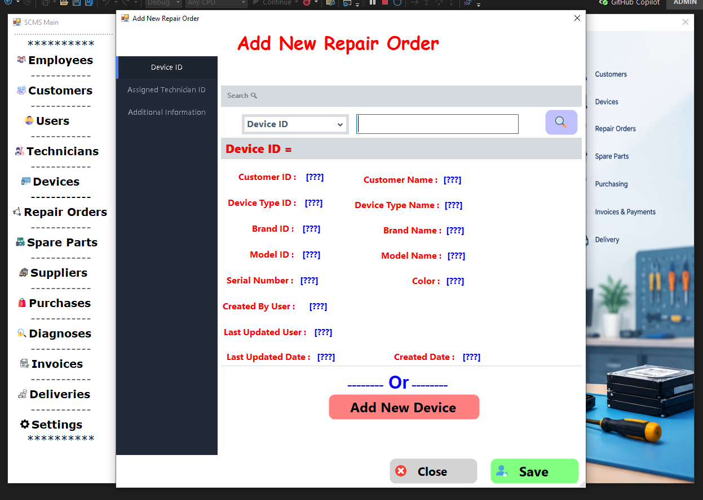
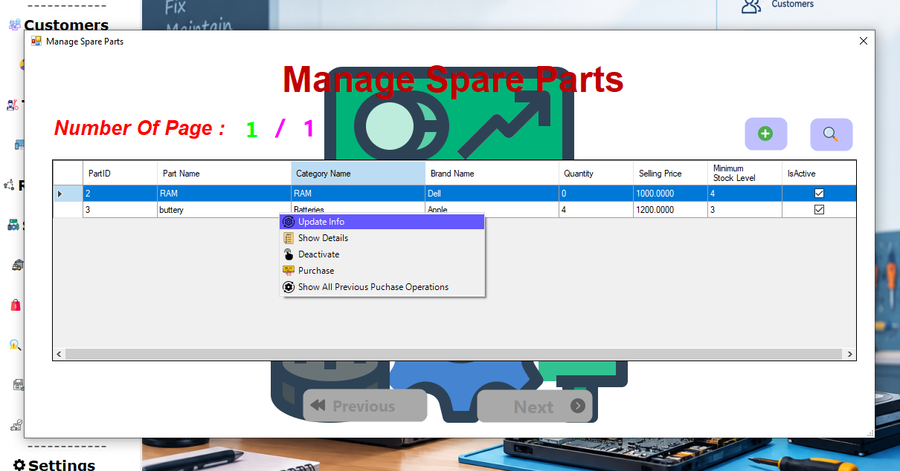
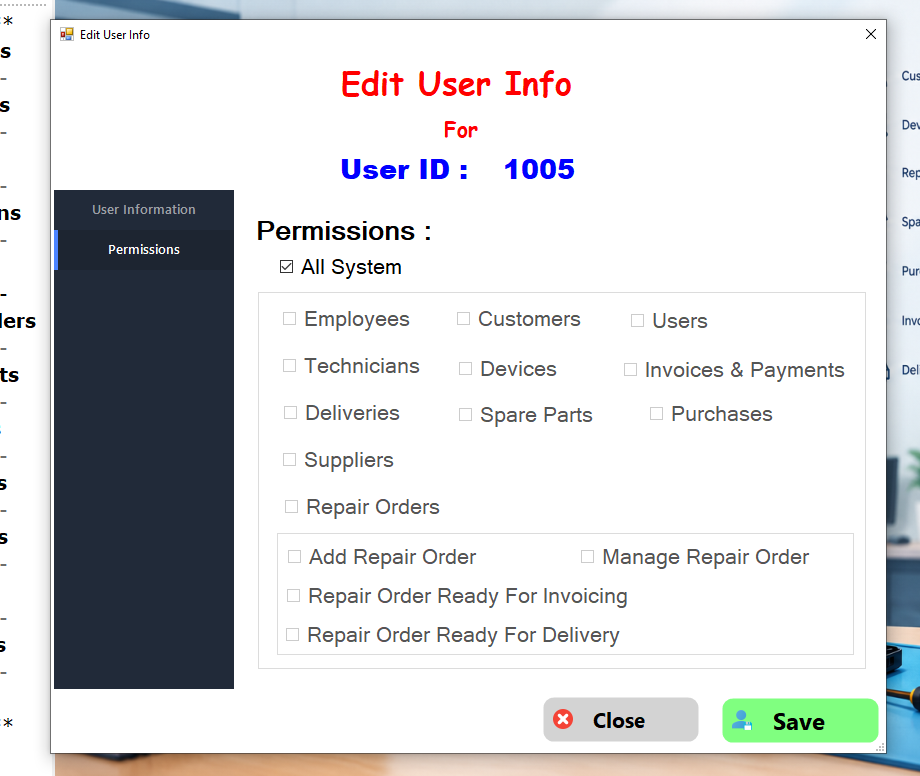

# Service Center Management System (SCMS)

A desktop application designed to manage electronic device maintenance operations, spare parts inventory, purchasing, invoicing, and payment tracking.

## 📌 Project Overview

The Service Center Management System (SCMS) helps electronic maintenance centers manage their daily operations, starting from receiving devices and diagnosing problems to performing repairs, issuing invoices, processing payments, and delivering devices to customers.

It also includes spare parts inventory and purchasing management to help track available stock and the parts used during maintenance.

## ✨ Features

### 🔧 Device & Repair Management
- Register and manage customer devices.
- Create and manage repair orders.
- Track repair progress through different statuses.
- Record device diagnosis and repair details.
- Track spare parts used during repairs.
- Manage device delivery.

### 👥 User Management & Permissions
- Manage system users and their roles.
- Support different system roles:
  - Administrator
  - Receptionist
  - Technician
  - Inventory Employee
- Control access to system operations based on user permissions.

### 📦 Spare Parts & Purchasing Management
- Manage spare parts and their information.
- Track available spare parts quantities.
- Manage suppliers and their information.
- Manage spare parts purchases from suppliers.
- Monitor stock quantity changes resulting from purchases.
- Prevent invalid stock operations.

### 💰 Invoicing & Payments
- Generate invoices for repair orders.
- Track payment statuses.
- Manage payment operations.
- Keep track of repair costs.

### 📋 System Monitoring & Logging
- Record important system activities.
- Track user login and logout events.
- Maintain audit information for important records.
- Log application events and errors.

## 🏗️ Architecture

The project follows the **3-Tier Architecture**, separating the application into three independent layers:

- **Presentation Layer:** Handles the user interface and user interactions using Windows Forms.
- **Business Logic Layer:** Contains business rules, validations, and application workflows.
- **Data Access Layer:** Handles database communication and data operations.

This separation improves maintainability, organization, and separation of concerns.

## 🛠️ Technologies & Concepts

**Programming & Framework**
- C#
- .NET Framework 4.7.2
- Windows Forms

**Database**
- SQL Server
- T-SQL
- ADO.NET

**Architecture & Programming Concepts**
- 3-Tier Architecture
- Object-Oriented Programming (OOP)
- Delegates & Lambda Expressions
- Generics
- Reflection & Attributes
- Serialization & Deserialization
- Multithreading
- Asynchronous Programming (async/await)
- Task Parallel Library (TPL)
- Exception Handling

**Other Technologies**
- XML
- App.config
- Windows Registry
- Windows Event Log
- Cryptography
- Symmetric & Asymmetric Encryption

## 🗄️ Database Setup

To run the application, you need to restore the database backup using **SQL Server Management Studio (SSMS)**.

1. Download the database backup file from the [`Database/SCMS.bak`](Database/SCMS.bak) folder.
2. Open SQL Server Management Studio (SSMS) and connect to your SQL Server instance.
3. Right-click **Databases** and select **Restore Database**.
4. Select **Device** as the source, then browse and select the downloaded `SCMS.bak` file.
5. Complete the restore process.

After restoring the database, update the connection string in the `App.config` file to match your SQL Server instance.

**Requirements:**
- SQL Server
- SQL Server Management Studio (SSMS)

## 📊 Database Diagrams

### Entity Relationship Diagram (ERD)

### Database Schema

## 🎯 Project Goals

This project focuses on strengthening practical software development skills through:

- Implementing complex business logic.
- Designing and managing relational databases.
- Applying separation of concerns using 3-Tier Architecture.
- Handling asynchronous operations and improving application responsiveness.
- Implementing user roles and permission management.
- Applying security, logging, and error-handling practices.

## 👩‍💻 Developer

**Mariam Yousry**

[GitHub](https://github.com/MariamYousry1234)

---

*Built to practice, apply, and strengthen software development skills through a real-world business application.*

## 📸 Screenshots

